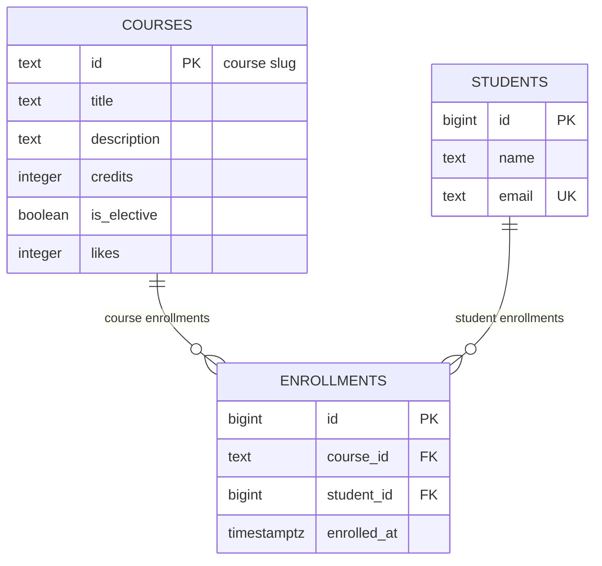

# course-catalog-db

PostgreSQL schema for the course catalog (Lab 6, "Advanced Web Technologies").

## How to run

PostgreSQL 16 or newer is required. Once, as the `postgres` superuser:

```sql
CREATE ROLE catalog_app LOGIN PASSWORD 'change-me';
CREATE DATABASE course_catalog OWNER catalog_app;
```

Then, from the project folder (it stops at the first error):

```bash
psql -h localhost -U catalog_app -d course_catalog -v ON_ERROR_STOP=1 -f schema.sql
psql -h localhost -U catalog_app -d course_catalog -v ON_ERROR_STOP=1 -f seed.sql
psql -h localhost -U catalog_app -d course_catalog -v ON_ERROR_STOP=1 -f queries.sql
```

The password `change-me` is for teaching; real projects keep passwords out of git.

---

## Schema



The schema has three tables. **courses** stores course metadata identified by a text slug (e.g. `modern-frontend`). **students** stores student records with unique emails. **enrollments** is the join table that implements the many-to-many relationship between courses and students: one course can have many enrollments, and one student can be enrolled in many courses.

---

## Design decisions

- **`courses.id` is text (a slug) while `students.id` is an automatic number.**
  Course IDs are human-readable slugs like `modern-frontend` that appear in URLs and are chosen by the content team — they carry meaning and change rarely, making text a natural fit. Student IDs have no natural key: we don't want to use email (it can change) or name (not unique), so an auto-generated `bigint` is the right choice. The downside of text PKs is that they take slightly more space and are slower to index than integers, but for a course catalog with hundreds of courses that trade-off is negligible.

- **`RESTRICT` on `enrollments.course_id` but `CASCADE` on `enrollments.student_id`.**
  Deleting a course that still has students enrolled would silently destroy enrollment history — that's a dangerous operation that should require explicit cleanup first, so `RESTRICT` forces the application to handle it intentionally. Deleting a student, on the other hand, means the person is gone from the system and their enrollments have no owner, so `CASCADE` removes them automatically as part of the same operation, keeping the data consistent without extra steps.

- **`timestamptz` and not `timestamp`; `text` and not `varchar(n)`.**
  `timestamptz` stores the moment in UTC and converts to the client's time zone on retrieval — without it, times stored during summer shift by an hour in winter. `text` in PostgreSQL has no performance or storage penalty compared to `varchar(n)`: both use exactly as much space as the value needs. `varchar(n)` adds an arbitrary length cap that requires a migration to raise, so `text` with a `CHECK` constraint (when a limit is actually meaningful, like for names) is the cleaner approach.

---

## Constraint violation log

Commands were run with `\set VERBOSITY verbose`.

| # | What we violate | SQLSTATE | Constraint | API response |
|---|-----------------|----------|------------|--------------|
| 1 | NULL in courses.title | 23502 | NOT NULL (column: title) | 422 Unprocessable Entity |
| 2 | courses.credits = 0 | 23514 | courses_credits_check | 422 Unprocessable Entity |
| 3 | courses.likes = -1 | 23514 | courses_likes_check | 500 Internal Server Error (bug in code) |
| 4 | a one-letter student name | 23514 | students_name_check | 422 Unprocessable Entity |
| 5 | a duplicate student email | 23505 | students_email_key | 409 Conflict |
| 6 | a duplicate course id | 23505 | courses_pkey | 409 Conflict |
| 7 | a repeated enrollment in a course | 23505 | enrollments_course_id_student_id_key | 409 Conflict |
| 8 | enrolling in a nonexistent course | 23503 | enrollments_course_id_fkey | 404 Not Found |
| 9 | enrolling a nonexistent student | 23503 | enrollments_student_id_fkey | 404 Not Found |
| 10 | deleting a course that has enrollments | 23001 | enrollments_course_id_fkey | 409 Conflict |
| 11 | deleting a student (CASCADE) | — no error — | ON DELETE CASCADE | enrollments dropped: 6 → 3, back to 6 after ROLLBACK |

**Why check in the database if Pydantic already validates?**
Pydantic runs inside the FastAPI process, but the database can be written to by other sources too — a migration script, a admin tool, a second microservice, or a developer running SQL directly in psql. If the constraint only exists in Pydantic, those other writers bypass it entirely. The database constraint is the last line of defense that guarantees data integrity regardless of which client writes to it. Two layers of validation also mean that the SQLSTATE code tells the API exactly which rule was violated, so it can return the correct HTTP status without parsing error messages.

---

## Index: EXPLAIN before and after

Query: `SELECT * FROM enrollments WHERE student_id = 777;`
Database `idx_demo`: 500 courses, 20,000 students, 50,000 enrollments.

| | Before the index | After the index |
|---|------------------|-----------------|
| Access method | Seq Scan | Bitmap Index Scan → Bitmap Heap Scan |
| cost | 0.00..1042.00 | 4.31..15.59 |
| Rows Removed by Filter | 49,997 | 0 (index cond, no filter scan) |
| Execution Time | 2.951 ms | 0.169 ms |

**Before the index:**
```
Seq Scan on enrollments  (cost=0.00..1042.00 rows=3 width=34)
                         (actual time=0.062..2.880 rows=3.00 loops=1)
  Filter: (student_id = 777)
  Rows Removed by Filter: 49997
  Buffers: shared hit=417
Execution Time: 2.951 ms
```

**After the index:**
```
Bitmap Heap Scan on enrollments  (cost=4.31..15.59 rows=3 width=34)
                                 (actual time=0.064..0.075 rows=3.00 loops=1)
  Recheck Cond: (student_id = 777)
  ->  Bitmap Index Scan on enrollments_student_id_idx
        (cost=0.00..4.31 rows=3 width=0)
        (actual time=0.045..0.045 rows=3.00 loops=1)
        Index Cond: (student_id = 777)
Execution Time: 0.169 ms
```

**Answers:**

1. **Why didn't PostgreSQL create an index on `enrollments.student_id` automatically?**
   PostgreSQL automatically creates an index only for `PRIMARY KEY` and `UNIQUE` constraints because those require an index to enforce uniqueness efficiently. `FOREIGN KEY` constraints have no such requirement — the database checks referential integrity by looking up the referenced table's primary key (which is already indexed). The referencing column (`student_id`) gets no automatic index, even though queries filtering by it are very common.

2. **Why does a primary-key lookup on `courses` (six rows) use `Seq Scan`, while on `enrollments` (50k rows) it goes through an index?**
   The planner compares estimated costs. Six rows fit on a single data page, so a sequential scan costs about 1.07 units. Using the index would add overhead (read the index page, then jump to the data page) for no benefit. With 50,000 rows spread across hundreds of pages, a sequential scan costs ~1042 units, while the index narrows the read to 2–3 pages, costing ~15 units. The planner picks the cheaper plan in each case.

3. **Two operations that the index on `student_id` speeds up:**
   - `SELECT * FROM enrollments WHERE student_id = ?` — the query that returns all of a student's enrollments (used by `GET /enrollments` filtered by student).
   - `DELETE FROM students WHERE id = ?` with `ON DELETE CASCADE` — when a student is deleted, PostgreSQL must find and delete all their enrollment rows; without the index it scans the whole enrollments table.

---

## Transaction

Scenario: enroll a new student in a course — two inserts in one transaction.

- **The second insert failed:** psql showed `ERROR: insert or update on table "enrollments" violates foreign key constraint`. The prompt changed from `=*>` (open transaction) to `=!>` (aborted transaction). All subsequent commands including a harmless `SELECT` were rejected with "current transaction is aborted, commands ignored until end of transaction block". After `ROLLBACK`, the student inserted in the first step was gone too — `count = 0`. No orphan student record was left in the database.

- **Window B saw `count = 0`** before `COMMIT` and **`count = 1`** after `COMMIT`. While the transaction in window A was open, its changes were invisible to any other connection. Both rows (student + enrollment) appeared atomically at the same instant the `COMMIT` was issued.

- **Without a transaction**, if the second insert had failed (nonexistent course), the student row inserted in the first step would have stayed in the database permanently — a student with no enrollment, no way to know why they exist, and a broken state that no application route would ever clean up. Transactions are the only way to guarantee "all or nothing" for multi-step operations.

---

## Self-review against the checklist

| What to check | Result |
|---------------|--------|
| Keys | ✅ Every table has a PRIMARY KEY. FOREIGN KEYs are declared on both `enrollments.course_id` and `enrollments.student_id`. |
| Types | ✅ `bigint` for auto-generated IDs, `timestamptz` for the enrollment moment, `text` for variable-length strings, `boolean` for yes/no, `integer` for counters. |
| Required values | ✅ All columns are NOT NULL. Nullable columns would allow silent missing data; every field here has a definite required meaning. |
| Constraints | ✅ CHECK on `credits > 0`, `likes >= 0`, `length(name) >= 2`; UNIQUE on `email` and `(course_id, student_id)`; consistent with Pydantic validators. |
| Deletion | ✅ RESTRICT on `course_id` (a course with students should not vanish silently) and CASCADE on `student_id` (a deleted user's history goes with them). Both chosen deliberately. |
| Normalization | ✅ Each fact lives in exactly one place. Course details are in `courses`, student details in `students`, and the relationship is only in `enrollments`. No lists in cells. |
| Indexes and names | ✅ Index added on `enrollments.student_id` (FK, not auto-indexed). Names follow snake_case throughout (`course_id`, `student_id`, `enrolled_at`). No speculative indexes added. |
